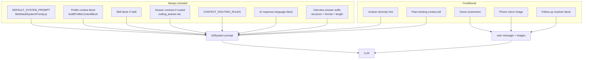

# VeilAssist Desktop — Behavior, Alignment & Wiring Reference

> **Purpose:** Explain what controls answers when modes, answer settings, and Intelligence toggles are on/off — so you can decide whether current logic is correct or needs changes.
>
> **Last reviewed:** 2026-08-22 (branch `veilassist-interview-1.0.24` area)

---

## Short answer to your question

**Yes — it is correct (by design) that answers still feel “mode-aware” and “resume-related” even when Intelligence / memory features are off.**

| Layer | Works when smart features OFF? | Why you still see Interview + resume examples |
|-------|-------------------------------|-----------------------------------------------|
| **Active mode** (e.g. Interview) | **Yes — always** | Injected on every Ask via `## ACTIVE PROMPT` + `MODE SESSION RULES` |
| **Resume / JD text** (Settings → Profile) | **Often yes** | Smart routing **off** actually includes **more** profile context, not less |
| **Answer structure / format / length** (General) | **Yes — always** | Appended to system prompt on every Ask |
| **Long-term memory recall** | **No** | Requires routing + backward-looking query |
| **Past-meeting vector search** | **No** (unless advanced flag on + query matches) | Gated by routing flags |
| **Auto mode suggestions** | **No** | `meetingModeAutoDetectEnabled === false` |

Your screenshot (“max pooling”, “ensemble techniques” + **SoftSensor.ai** example) matches **Interview mode + resume/profile in context + Conversational/CAR suffix** — not long-term memory.

---

## What goes into every Ask (prompt stack)

Every overlay Ask (`ask-ai-with-transcript` → `handleAskAI` in `main/index.js`) builds the model request in this order:



### 1. Built-in system prompt (always)

**File:** `lib/defaultSystemPrompt.js` → `resolveSystemPrompt(store.systemPrompt)`

Includes `<core_identity>`, `<candidate_voice>`, `<execution_contract>`, `<technical_problems>`, etc.

- **Interviewee behavior** is baked in here too (first person, resume for “tell me about yourself”).
- Optional **user persona supplement** from Settings is appended if non-empty.

### 2. Active profile mode (almost always)

**Files:** `lib/contextPrompts.js`, `main/index.js` → `buildProfileContextBlock`

When a mode like **Interview** is selected in the overlay picker:

```
## ACTIVE PROMPT (Interview)
I am in a job interview as the interviewee...
```

Plus **`## MODE SESSION RULES — INTERVIEW`** (first person, speakable answers, STAR for behavioral, code if screen shows coding, use reference files, etc.).

**Wiring:**

| Store key | UI |
|-----------|-----|
| `activeContextPromptId` | Overlay mode picker |
| `contextPrompts[]` | Settings → Profile modes |

`formatActivePromptBlock()` + `formatModeSessionRules()` run whenever `useAll || routeDecision.useActiveMode`.

### 3. Resume / JD / reference files

**Files:** `main/index.js` → `buildProfileContextBlock`, `lib/contextRouter.js`, `lib/answerPlanner.js`

| Intelligence routing | `routeDecision` | Profile injection |
|---------------------|-----------------|-------------------|
| **ON** (`intelligenceRoutingEnabled !== false`) | Computed per question | **Selective** — resume/JD/refs only when planner says relevant |
| **OFF** | `null` → `useAll = true` | **Broad** — mode + resume + JD + reference files + knowledge base (if present) on **every** Ask |

> **Important:** Turning off “Smart context routing” does **not** mean “ignore my resume.” It means “stop being selective” and include static profile blocks more aggressively.

**Stronger candidate voice** (`profileTreeV2Enabled`, default on):

- Uses structured resume/JD trees + optional embedding retrieval.
- Adds `buildProfileTreeV2VoiceGuard()` when resume/JD blocks are present (anti-hallucination + first-person rules).
- For interview/meeting **domains** (when routing is on), V2 voice is forced even if the toggle is off.

### 4. Interview answer settings (General tab — always on Ask)

**Files:** `lib/interviewSettingsCatalog.cjs`, `lib/interviewAnswerPrompt.cjs`, `main/index.js` line ~2839

| Store key | UI label | Prompt effect |
|-----------|----------|---------------|
| `answerStructure` | Answer structure (STAR/CAR/…) | `structurePrompt()` line in suffix |
| `responseFormat` | Bullet / Conversational / Example-Driven | `formatPrompt()` + mode override block |
| `answerLength` | Short / Medium / Long | Word target + `maxTokensForAnswerLength()` |
| `interviewCustomInstructions` | Custom instructions | Appended to suffix |
| `aiResponseLanguage` | Response language | Separate language block |

**Also affects overlay display (not the LLM):**

| `responseFormat` | `answerStyle` saved | Overlay layout |
|------------------|---------------------|----------------|
| `bullets` | `brief` | Takeaway + bullets shell |
| `conversational` / `example` | `detailed` | Full markdown / prose shell |

**Format overrides (suffix tail — wins over generic markdown when conflicting):**

| Format | Override block |
|--------|----------------|
| Conversational | `SPOKEN INTERVIEW MODE` — fillers (Hmm…), no Takeaway headings |
| Example-Driven | `INTERVIEW ANSWER MODE — EXAMPLE-DRIVEN` — point + example, no fillers |
| Bullets | `INTERVIEW ANSWER MODE — BULLETS` — short bullets for non-coding |

### 5. Intelligence / memory (conditional)

**Registry:** `lib/intelligenceFlags.js`

#### Master switch: “Enable smart features”

**UI:** Settings → Intelligence → Enable smart features  
**Wiring:** `renderer/settings/IntelligenceSettingsPanel.jsx` → sets all **core** flag store keys together:

| Core flag | Store key | Default |
|-----------|-----------|---------|
| Smart context routing | `intelligenceRoutingEnabled` | `true` |
| Long-term memory | `longTermMemoryEnabled` | `true` |
| Auto-detect meeting type | `meetingModeAutoDetectEnabled` | `true` |
| Stronger candidate voice | `profileTreeV2Enabled` | `true` |

#### Long-term memory (past meetings)

**Files:** `lib/longTermMemory.js`, `main/index.js` → `finalizeMeetingSession`, `hindsight.hybridRecall`

| When | Behavior |
|------|----------|
| Session ends (Listen off) | `longTermMemory.retain()` **if** `longTermMemoryEnabled !== false` |
| On Ask | Recall **only if** routing is on **and** `routeDecision` requests `useHindsightRecall` / `useMeetingSummary` / `useHybridRag` **and** query is backward-looking |

**Not** what powers “at SoftSensor.ai I implemented…” in a live technical answer — that comes from **resume text** in Profile.

#### Advanced flags (Customize section)

| Flag | Store key | Effect |
|------|-----------|--------|
| Vector memory | `vectorMemoryEnabled` | Semantic recall; keyword fallback always exists |
| Search past meetings | `globalMeetingSearchEnabled` | Overlay search pill |
| Answer diversity | `answerDiversityEnabled` | Extra STYLE hint in system prompt |
| Reference file vectors | `referenceVectorIndexEnabled` | Embedding retrieval for playbook chunks |
| Smart follow-up drafts | `followUpDraftEnabled` | Calendar follow-up generation |

#### Same-session follow-ups (separate from LTM)

| Store key | Default | Effect |
|-----------|---------|--------|
| `conversationFollowUpsEnabled` | `false` | `resolveConversationFollowUp()` — pronoun / “tell me more” resolution within overlay session. With **Auto-answer** on, exchanges are also remembered (RAM only) so auto-answered follow-ups get the prior exchange — see *Auto-answer: follow-ups* |

---

## Overlay trigger wiring (what context is attached)

**File:** `renderer/overlay/App.jsx` → `handleAsk`, `lib/askContextPriority.cjs`

| Trigger | `promptMode` | Screen capture | Primary context |
|---------|--------------|----------------|-----------------|
| Auto-answer (speech) | `audio` | Yes if provider supports vision & `noScreen` false | Transcript-led; screen is supplementary |
| **Ctrl+Enter** | `screen` (if no competing speech) | Yes (pre-capture on hotkey) | Screen-led |
| **Ctrl+Shift+Enter** | `audio` | **No** (`noScreen: true`) | Audio/text only |
| Typed question + Enter | `typed` | Optional | Typed question primary |
| Action chips | typed + screen | Yes (`noScreen: false`) | Chip prompt |

**Session gate:** Listen toggle must be **ON** for overlay Ask/hotkeys (except global chat).

### Auto-answer: how a question is judged ready

```mermaid
flowchart TB
  T[final segment lands, or 500ms tick:<br/>maybeTriggerAI] --> G{still reading last answer<br/>(mic speech only under the AI gate) /<br/>readback / min length?}
  G -- yes --> W[wait]
  G -- no --> E{questionDetectionEngine}
  E -- rules --> R[isUtteranceReadyForAutoAnswer<br/>+ 2.8s silence]
  E -- ai --> S{final segment just landed,<br/>or silence ≥ 0.9s?<br/>and this text not already judged}
  S -- no --> W
  S -- yes --> Q[detection coordinator:<br/>one check at a time, newest text queued]
  Q --> D[IPC detect-question<br/>lib/questionDetector.cjs]
  D --> V{decideAutoAnswerAction}
  V -- fire --> A[handleAsk auto + detected verdict]
  V -- wait --> W
  V -- rejudge --> T
  V -- fallback --> R
  R --> A
```

**AI-assisted engine (default).** `renderer/overlay/App.jsx → requestQuestionDetection` submits the buffered speech to the **detection coordinator** (`createDetectionCoordinator`). `processTranscribedText` already calls `maybeTriggerAI` on every finalized segment; with `{ fromFinal: true }` the AI path skips the 0.9 s minimum-silence wait (the STT has already ended the utterance — Deepgram holds sentence finals until `UtteranceEnd`), while the 500 ms tick path still waits for a pause so half-heard text isn't re-sent. The coordinator runs **one check at a time**; while it runs, only the *newest* text waits in a single slot and is checked next — unless the running check fired an answer, or the queued text is > 0.95 similar to what was just checked. Each check sends the last 6 finalized turns plus the session's **answered-questions ledger** to the main process (`detect-question` → `handleDetectQuestion` → `detectQuestion`). The model returns `{ question, question_final, requires_personal_info }`. The result is routed through `decideAutoAnswerAction`:

| Action | When | Effect |
|--------|------|--------|
| `fire` | Final, new question; pipeline free; cooldown elapsed | `handleAsk(null, { auto: true, detected })` |
| `wait` | No question, a repeat/fragment, or still mid-sentence | Keep the cached verdict — no new model call until the text or silence bucket (`early`/`late`, 3.5 s) changes |
| `rejudge` | Speaker kept talking while the model thought, pipeline busy, or cooldown | Clear the cache. For stale text the coordinator checks the newer queued text immediately; otherwise the next tick asks again |
| `fallback` | No key / engine off / error / timeout / unparseable reply | Rule path for 30 s. A *degraded* verdict (rules answered inside the main process) never fires early — the rule path keeps its own longer silence window |

The ledger is recorded **only after a confirmed turn** (`ask-ai-with-transcript` → `{ ok: true }`) and cleared on Clear (`Ctrl+R`), session purge, and every Listen start/stop, so a failed ask stays retryable and a new session starts clean. Deterministic backstop: `isDuplicateOfAnswered` drops a question whose normalized text (case and punctuation stripped) is more similar to an answered one than the **Repeat filter** threshold — strict 0.85 / balanced 0.90 (default) / lenient 0.95, `questionRepeatSensitivity` — or that is a head/tail fragment of one. The model separately judges same-*meaning* repeats; follow-ups that expand a question are not duplicates.

**Provider failure handling.** `handleDetectQuestion` calls the model through `completeWithFallback` (`lib/chatFallbackProvider.cjs`): primary → Groq (NVIDIA primary + Groq key, the same net the answer path has) → the opt-in **Fallback provider** (`chatFallbackProvider`). A 403/404/410/408/429/5xx, connection error or empty reply hands over; a non-eligible error (e.g. 400) does not. A non-final attempt is cut off after 2.5 s so a hung provider cannot spend the whole 4.5 s budget. Answers get the same opt-in provider appended after the NVIDIA model chain and the Groq text fallback (`buildFallbackAttempt` + `dedupeAttempts`); screenshot asks only use a vision-capable fallback.

**Parity with InterviewMan's flow.** `scripts/test-autoanswer-parity.cjs` replays scripted conversations (single question, STT re-emission, reworded repeat, follow-up, unfinished question, overlapping checks, queued near-identical text, found-question-drops-queue, and each repeat-filter level) through an independent reference model of his flow and through this coordinator/detector, and requires identical fired questions and model-call counts. One difference is intentional and asserted: VeilAssist also drops head/tail fragments of an answered question, where his flow relies on the model.

**`requires_personal_info` → routing.** The verdict rides on the ask as `detectedRequiresPersonalInfo` and is applied by `applyPersonalInfoSignal` (`lib/contextRouter.js`) right after `routeContext`:

| Verdict | Planner said | Result |
|---------|--------------|--------|
| `false` | `behavioral_interview_answer`, question has **no** personal cue (`you`/`your`/`a time when…`) | Reclassified `technical_concept_answer`: resume + JD off, `technical_explanation` contract, no first-person identity block |
| `false` | `identity_answer` / `jd_*` / personal cue present | Unchanged — losing the resume is the worse failure |
| `false` | `general_assistant` / `technical_concept_answer` | Resume + JD off |
| `true` | resume was off | Resume on (if one exists and policy isn't `forbidden`) |
| any | `coding_*`, or verdict `null` (rules fallback) | Unchanged |

This fixes the "what is max pooling?" → "…at {employer}" case listed under *Known tensions* for auto-answered questions. It needs **Smart context routing ON** (with routing off, `useAll` still injects the whole profile by design). Typed and hotkey asks have no detector verdict and behave as before.

### Auto-answer: follow-ups

Every ask is a single-turn model call and the answered question's transcript is consumed, so a spoken follow-up ("and what was the hardest part there?") used to reach the model with nothing to refer to — only the typed-chat patterns in `followUpResolver.js` (bare "why?", "make it shorter", "previous question") attached the earlier answer. Replaying twelve realistic interviewer follow-ups through the old logic: 8 reached the model cold, and 6 were classified `continuation`, which glued the answered question back on and re-fired it — including plain "okay, great, thanks for that."

| Piece | Where | What it does |
|-------|-------|--------------|
| `is_follow_up` verdict | `lib/questionDetector.cjs` | A fourth model field (boolean, `null` when the model omits it or the rules answered). Rides on the ask as `detectedIsFollowUp`; logged as `follow=` |
| Prior-exchange context | `resolveAutoFollowUp` in `lib/followUpResolver.js`, applied in `handleAskAI` | For an **auto-answered speech ask** (`_askMeta.auto === true`, source `speech`), a follow-up gets the last ≤ 2 exchanges (≤ 10 min old; newest answer clipped to 1400 chars) **appended** as `## PRIOR EXCHANGE … context only`. The detector verdict decides; with no verdict (rules engine, degraded check) `looksLikeSpokenFollowUp` guesses from openers (`and`, `so`, `also`…) and back-references (`that`, `it`, `there`, `you mentioned`…). The routing query also includes the earlier question, so the resume/JD decision follows the topic |
| Memory while Auto-answer is on | `handleAskAI` | Overlay exchanges are recorded in `conversationMemory` (RAM only, cleared with the session) when **either** `conversationFollowUpsEnabled` is on **or** the overlay reports Auto-answer on (`autoAnswerOn` in the ask meta, sent with every ask — manual asks included, so an auto follow-up can refer to a manual answer). `handleAskAI` never reads `assistAutoTrigger` / `overlayAnswerAutoScroll` (pinned by `test-desktop-interview-wiring.cjs`: the prompt must not depend on those toggles). Typed-chat follow-up resolution is still gated by `conversationFollowUpsEnabled` alone |
| No canned clarification | `handleAskAI` | A typed-chat match that would answer "Can you clarify what you want me to explain?" is dropped for auto asks — an auto-answer works from the transcript instead |
| Acknowledgements | `isAcknowledgement` in `lib/phoneAutoAnswer.cjs` | "okay", "great, thanks for that", "interesting" classify as `ignore` and never re-fire the answered question (rules path) |
| AI gate after an answer | `commit()` in `renderer/overlay/App.jsx` | With the AI gate on, leftover speech is **not** regex-classified or glued to the answered question; the cached verdict is cleared and the detector judges the leftover on the next tick |
| Queued follow-up | `maybeTriggerAI` | Under the AI gate nothing is queued in `pendingFollowUpRef`, and `speech` is always the live buffer. Previously a follow-up queued during the readback hold pinned `speech` to old text, so the detector's cache key never changed and later speech was never re-judged |
| Readback hold | `readbackHoldApplies` | The hold ("user is still reading the last answer aloud") protects against the user's own readback, which is always on the **mic** channel. Under the AI gate, speech whose newest pending segment is on the **system** channel skips the hold and is judged as soon as it is heard; mic speech and single-channel setups keep it |

Not changed: the rules engine keeps its hold, the `continuation` glue for unfinished scenarios, and the 2.8 s silence window. Manual (typed / hotkey) asks keep the typed-chat resolver exactly as before. Tests: `scripts/test-autoanswer-followups.cjs` (19) — replay of the twelve follow-ups, verdict-vs-heuristic precedence, staleness/size bounds, hold bypass, and wiring checks on `main/index.js` and the overlay.

**Related prompt changes (all asks).** Screen-led asks append `SCREEN_QUESTION_RULES` (answer the last *fully visible* question, one heading per question when several, answer first); any ask with a transcript appends `TRANSCRIPT_ERROR_NOTE` (speech-recognition errors — infer the intended term). Both live in `lib/screenQuestionRules.cjs`.

---

## Alignment matrix — mode × answer settings × task type

Use this to decide if your **settings match the task**.

| Task type | Recommended mode | Answer structure | Response format | Trigger |
|-----------|------------------|------------------|-----------------|---------|
| Behavioral interview (spoken) | Interview / Looking for work | CAR or STAR | Conversational or Example-Driven | Listen + auto or mic |
| Technical concept (“what is max pooling?”) | Interview or Gen AI engineer | Any (structure applies weakly) | Example-Driven or Bullets | Speech or typed |
| Live coding on screen | Gen AI engineer | N/A | **Bullet Points** | **Ctrl+Enter** (screen-led) |
| “What did we decide last week?” | Any | Any | Any | Needs **LTM + routing ON** |
| Meeting notes / recap | Team meet | N/A | Bullets | Listen → Stop session |

### Known tensions (current logic)

| Combination | What happens | Recommendation |
|-------------|--------------|----------------|
| Interview + Conversational + coding on screen | Spoken override fights `<technical_problems>` (Takeaway + full code) | Use Bullets + technical mode + Ctrl+Enter |
| CAR + pure definition question | Model may still add “for example at {employer}…” from resume | Fixed for **auto-answered** questions (AI-assisted engine + smart routing on — see *Auto-answer* above); typed/hotkey asks still behave this way in Interview mode with resume loaded |
| Smart routing OFF | More resume/JD every Ask; **no** LTM recall | Good for “always use my background”; bad for token noise |
| Smart routing ON | Less resume noise; adds recall for backward questions | Default for production |

---

## Your screenshot explained

**Settings observed:** Interview mode, CAR, Conversational, Medium, Intelligence toggles off.

**Question:** “what is max pooling layer?”  
**Answer shape:** Definition + CNN example + first-person resume tie-in — **correct for Interview mode with resume in profile**, regardless of LTM.

**Question:** “what are the ensemble techniques…”  
**Answer mentions SoftSensor.ai** — almost certainly from `resumeContext` / resume tree retrieval, **not** from long-term memory (routing off blocks hindsight recall path).

**Why CAR / Conversational still show:**

- CAR is in the **interview answer suffix** (appended every Ask).
- Conversational adds **spoken override** (fillers, first-person flow).
- Interview **MODE SESSION RULES** also say behavioral → STAR (4 sentences) — CAR suffix and mode rules can overlap; the model merges them.

---

## Store keys quick reference

### Profile & mode

| Key | Purpose |
|-----|---------|
| `contextPrompts` | All mode definitions |
| `activeContextPromptId` | Selected overlay mode |
| `resumeContext` | Resume text |
| `jdContext` | Job description |
| `resumeTree` / `jdTree` | Parsed structure for V2 voice |
| `knowledgeBase` | Legacy global reference (fallback if no ref files) |

### General answer settings

| Key | Default |
|-----|---------|
| `answerStructure` | `star` |
| `responseFormat` | `bullets` |
| `answerLength` | `medium` |
| `interviewCustomInstructions` | `''` |
| `aiResponseLanguage` | match question |
| `answerStyle` | derived from `responseFormat` |
| `assistAutoTrigger` | user preference |
| `questionDetection` | `high` |
| `questionDetectionEngine` | `ai` (`rules` = on-device only) |
| `questionDetectionModel` | `''` (empty = the active chat model) |
| `questionRepeatSensitivity` | `balanced` (`strict` 0.85 / `lenient` 0.95) |
| `chatFallbackProvider` | `''` (none; opt-in second chat provider) |

### Intelligence

| Key | Default |
|-----|---------|
| `intelligenceRoutingEnabled` | `true` |
| `longTermMemoryEnabled` | `true` |
| `meetingModeAutoDetectEnabled` | `true` |
| `profileTreeV2Enabled` | `true` |
| `vectorMemoryEnabled` | `true` |
| `answerDiversityEnabled` | `false` |
| `conversationFollowUpsEnabled` | `false` |
| `hindsightProvider` | `off` |

---

## Code map (main wiring files)

| Concern | Primary files |
|---------|---------------|
| Ask pipeline | `main/index.js` → `handleAskAI`, `buildProfileContextBlock` |
| Overlay session + auto-answer | `renderer/overlay/App.jsx` |
| Question detection (model verdict, ledger, fallback) | `lib/questionDetector.cjs`, `main/index.js → handleDetectQuestion`, `renderer/shared/questionDetector.js` |
| Personal-info routing | `lib/contextRouter.js → applyPersonalInfoSignal` |
| Cross-provider fallback | `lib/chatFallbackProvider.cjs`, `main/index.js` (`handleAskAI`, `handleDetectQuestion`), `lib/chatStreamFallback.js` |
| InterviewMan parity test | `scripts/test-autoanswer-parity.cjs` |
| Mode prompts & session rules | `lib/contextPrompts.js` |
| Question → context layers | `lib/answerPlanner.js`, `lib/contextRouter.js` |
| Answer shape suffix | `lib/interviewSettingsCatalog.cjs`, `lib/interviewAnswerPrompt.cjs` |
| LTM retain/recall | `lib/longTermMemory.js`, `lib/hindsightClient.js` |
| Intelligence UI | `renderer/settings/IntelligenceSettingsPanel.jsx` |
| General answer UI | `renderer/settings/DisplaySettingsPanel.jsx`, `renderer/settings/App.jsx` |
| Display / bubbles | `renderer/overlay/components/ResponsePanel.jsx`, `renderer/overlay/index.css` |

---

## Automated wiring tests

Run after changing prompt or settings logic:

```bash
node scripts/test-desktop-interview-wiring.cjs
node scripts/test-general-answer-settings-wiring.cjs
node scripts/test-ask-context-priority.cjs
node --test scripts/test-question-detector.cjs
node --test scripts/test-autoanswer-parity.cjs
node --test scripts/test-chat-fallback-provider.cjs
```

`test-question-detector.cjs` covers verdict parsing, duplicate/fragment handling, the ledger, timeout and fallback, the fire/wait/rejudge/fallback decision table, personal-info routing through the real planner, and the wiring from the setting to the model call (store → preload allowlist → IPC → router → overlay → settings UI).

These assert: suffix includes structure/format/length, conversational vs example overrides, overlay display coupling, and Ask path imports.

---

## Decision guide — should you change logic?

| If you want… | Current behavior | Possible change |
|--------------|------------------|-----------------|
| Mode affects tone but **never** resume unless asked | Resume still injected (especially routing OFF) | Add “profile injection off” flag or stricter routing when master switch off |
| CAR only for behavioral, ignored for definitions | Both mode rules + suffix apply | Split suffix by `answerPlanner.answerType` |
| Conversational never breaks coding | Overrides conflict | Detect `coding_answer` contract → skip spoken override |
| Smart features OFF = minimal context | Opposite today (`useAll`) | Change `useAll` semantics when routing off |
| LTM off = zero personal examples | Resume still used | Clear resume or add “anonymous mode” |

---

## Related user docs

- [05-asking-ai.md](./user-guide/05-asking-ai.md) — triggers and context sources  
- [08-intelligence-and-memory.md](./user-guide/08-intelligence-and-memory.md) — Intelligence toggles  
- [06-profile-and-skills.md](./user-guide/06-profile-and-skills.md) — modes, resume, skills  

---

## Glossary

| Term | Meaning |
|------|---------|
| **Mode** | Profile prompt (Interview, Gen AI engineer, …) — role and session rules |
| **Answer settings** | Structure / format / length — output shape |
| **Smart routing** | Per-question decision of which profile layers to inject |
| **LTM** | Long-term memory — past session summaries recalled later |
| **Session memory** | Short rolling transcript buffer during Listen |
| **Suffix** | Interview answer rules appended last to system prompt |
